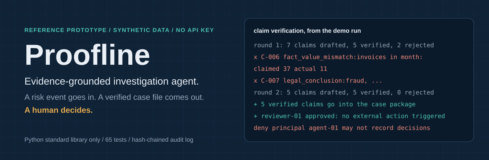
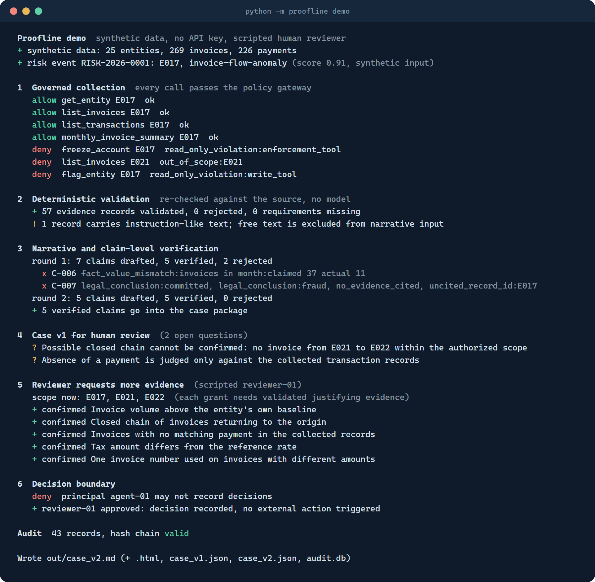
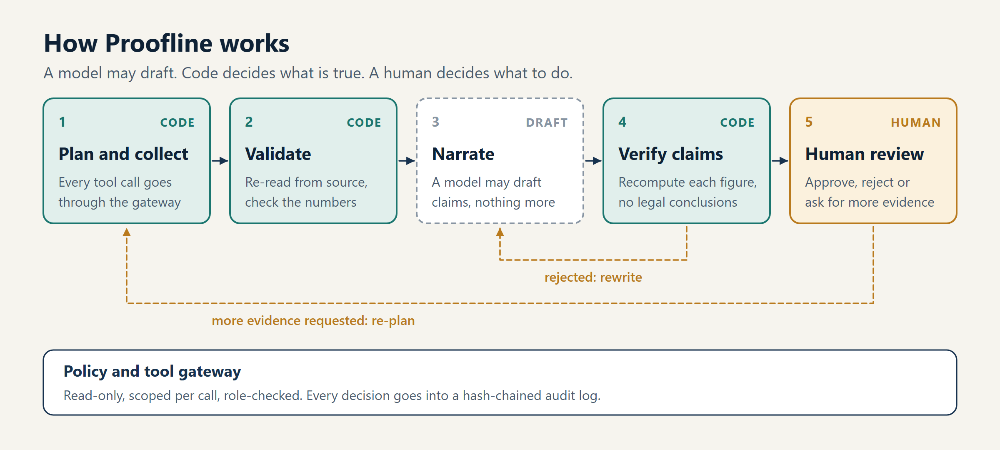
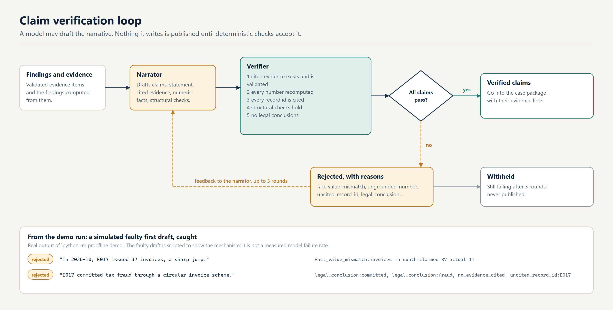

<p align="center">
  
</p>

# Proofline

**An investigation agent that cannot assert what it cannot prove.** A risk event goes in. Every statement in the case file that comes out is tied to a source record, re-checked by code, and reviewed by a human who makes the decision.

<p align="center">
  <a href="https://github.com/mustafa-akgul/proofline/actions/workflows/ci.yml"></a>
</p>

Proofline is a reference prototype of that idea, built on synthetic invoice and payment data. It runs offline with the Python standard library, needs no API key, and ships with 65 tests.

```bash
git clone https://github.com/mustafa-akgul/proofline.git && cd proofline
pip install -e ".[dev]"
python -m proofline demo        # well under a second, writes out/case_v2.md
python -m pytest                # 65 tests
```

## The 10-second version

- **Every tool call goes through one gate.** Read-only by policy and by the database handle, scoped to the entities in the case, audited in a hash-chained log.
- **A model may draft, never decide what is true.** Claims are checked by deterministic code: numbers recomputed from evidence, ids cited, no legal conclusions. Rejected claims go back; claims that keep failing are withheld.
- **A human decides.** Approve, reject, or ask for more evidence. The agent cannot approve its own case, and an approval triggers no external action.

<p align="center">
  
</p>

<p align="center"><sub>Real output of <code>python -m proofline demo</code>. The reviewer is scripted and the first narrative draft is deliberately faulty, to show the checks working. <a href="assets/demo.svg">Animated version</a>.</sub></p>

## What it is, and what it is not

| It is | It is not |
|---|---|
| A worked design for an evidence-to-case workflow, with the safety-critical core implemented and tested | A product, a deployed system, or something with measured accuracy |
| A demonstration that claim verification, policy enforcement and audit can be plain, testable code | An LLM application. The default narrator is a deterministic template; the model adapter is an unimplemented interface |
| Runnable end to end on synthetic data in well under a second | Connected to any real data source, detector or case-management system |
| Explicit about what is designed but not built (see [status](#status)) | A fraud detector. Detection is upstream and out of scope; Proofline starts from a risk event |

The invoice-ring scenario is fictional. All entities, amounts and the "risk score" are generated.

## How it works

<p align="center">
  <picture>
    <source media="(prefers-color-scheme: dark)" srcset="assets/overview-dark.png">
    
  </picture>
</p>

The [one-page executive architecture](assets/architecture-executive.png) shows every component and what is built versus design only.

1. **Plan and collect.** The controller asks for evidence through the gateway. Each record becomes an evidence item with its tool, query, parameters and call id.
2. **Validate.** Code re-reads each record from the source through a separate read-only handle, checks numeric sanity, and reports what is missing. Only validated items continue.
3. **Analyze.** Rule-based findings from validated evidence: volume against the entity's own baseline, closed invoice chains, tax amounts, reused invoice numbers, invoices without a matching payment. A finding is *confirmed* or only a *candidate*.
4. **Narrate and verify.** Findings become claims. The verifier accepts a claim only if its evidence exists and is validated, every number matches a value recomputed from that evidence, every record id in the text is cited, its structural checks hold, and it contains no legal conclusion.
5. **Review.** The case package lists verified claims, an evidence matrix, a timeline, the entity graph, and what could not be established. The reviewer can ask for more evidence; the request re-enters at step 1, and the scope grows only when a validated record actually names the new entity.

In the demo, version 1 of the case can only say a closed invoice chain is *possible*, because the connecting invoice is outside the authorized scope. The reviewer's request widens the scope under policy, and version 2 confirms the chain.

<p align="center">
  <picture>
    <source media="(prefers-color-scheme: dark)" srcset="assets/claim-verification-loop-dark.png">
    
  </picture>
</p>

The [engineering architecture](assets/architecture-engineering.png) shows the trust zones, modules and data contracts. [`docs/ARCHITECTURE.md`](docs/ARCHITECTURE.md) covers them in prose, including the threat model for instructions hidden in evidence text.

## Sample output

[`examples/case_v2.md`](examples/case_v2.md) is the case package the demo produces. The summary section reads:

> **C-002** (observation): 3 invoices issued between 2026-10-06 and 2026-10-21 form a closed chain E017 -> E021 -> E022 -> E017, totalling 1,425,000.00 currency units, none with a matching payment in the collected transaction records.

Every number in that sentence is recomputed from the three cited invoices before the sentence is allowed into the package. The JSON and HTML versions are alongside it.

## Status

| Component | Status |
|---|---|
| Synthetic data with planted anomalies | Built, tested (deterministic generation) |
| Policy and tool gateway: identity, role, read-only, purpose, scope, row limit, scope grants | Built, tested |
| Append-only, hash-chained audit log (SHA-256, triggers reject UPDATE and DELETE, tamper detection) | Built, tested |
| Evidence items with provenance; deterministic validation and completeness report | Built, tested |
| Relationship, pattern and timeline analysis | Built, tested (rule-based) |
| Claim verifier, including a deliberately hallucinated claim being caught | Built, tested |
| Narrator | Template narrator built. Simulated faulty narrator built for the demo. **LLM adapter: interface only** |
| Case package (JSON, Markdown, HTML), human review with evidence-request loop | Built, tested. Reviewer is an API call, **no UI** |
| Policy engine | JSON policy evaluated in Python. **Open Policy Agent: design only** |
| Orchestration | Plain state machine. **LangGraph: design only** |
| Tool interface | Local tool registry. **MCP server: design only** |
| Data layer | SQLite. **PostgreSQL, or Trino over Iceberg: design only** |
| Provenance and tracing | Provenance fields and audit log. **OpenLineage and OpenTelemetry export: design only** |
| Graph analysis | Pure Python over invoices. **Graph database (Apache AGE, Neo4j): design only** |
| Upstream detector | Input contract only. **Detector: out of scope** |
| Audit head hash anchored outside the database | **Design only** |

No performance figures are claimed. There is no benchmark, no customer and no deployment behind this repository.

## Why these choices

- **Plain state machine, not an agent framework.** Every transition is explicit, audited and testable. The graph maps directly onto LangGraph if branching grows.
- **Policy as data in front of every tool.** Reading `policy.json` is how a reviewer sees what an agent may do. Moving the same rules to OPA keeps the gateway's shape.
- **Verification by recomputation, not by asking a second model.** A fact is accepted because code reproduced it from cited records, which is cheap, repeatable and explainable to a reviewer.
- **Free text is data.** A record in the demo contains a note that tries to instruct the agent. It is flagged, kept as evidence, withheld from the narrator, and has no effect on any finding (tested).
- **Stdlib only.** Nothing to install, nothing to configure, nothing that can drift.

## Tests

`python -m pytest` runs 65 tests:

| File | Tests | Covers |
|---|---|---|
| `test_gateway.py` | 15 | allow and deny reasons, enforcement tools refused, scope, scope grants and cap, row limit, write attempts on the data handle |
| `test_evidence.py` | 14 | provenance, de-duplication, re-verification against source, numeric sanity, completeness, injection-like text |
| `test_verifier.py` | 13 | hallucinated numbers, fabricated ids, legal wording, missing evidence, structural checks, recomputed predicates |
| `test_pipeline.py` | 17 | findings and candidates, faulty draft repaired, stubborn narrator withheld, evidence-request loop, role limits on decisions, package contents, HTML escaping, end-to-end demo, reproducibility |
| `test_audit.py` | 4 | chain validity, rejected UPDATE and DELETE, tamper and deletion detection |
| `test_synth.py` | 2 | deterministic generation, planted anomalies present |

The numbers in the demo's claims are also cross-checked against the database in a test.

## Repository layout

```text
src/proofline/
  contracts.py      data contracts (RiskEvent, ToolCall, EvidenceItem, Claim, ...)
  gateway.py        policy and tool gateway, scope grants      policy.json
  tools.py          governed tools (read-only) and refused enforcement tools
  evidence.py       evidence store, provenance, deterministic validation
  analysis.py       findings, timeline, entity graph
  narrator.py       template narrator, simulated faulty narrator, LLM seam
  verifier.py       claim-level verification
  investigation.py  controller and human review
  casepkg.py        case package: JSON, Markdown, HTML
  audit.py          hash-chained append-only log
  synth.py          synthetic data with planted anomalies
  cli.py            python -m proofline demo | audit-verify
tests/              65 tests
docs/               CASE_STUDY, ARCHITECTURE, VERIFICATION
assets/             diagrams (SVG and PNG), terminal recording
scripts/            regenerates every asset: build_visuals.py, build_terminal.py
examples/           case package produced by the demo
```

Regenerate the visuals with `python scripts/build_visuals.py` and `python scripts/build_terminal.py` (PNG export uses a locally installed Chrome or Edge).

## Limitations

- Synthetic data and one scenario. The rules are tuned to the planted patterns and say nothing about real-world detection quality.
- The planner is fixed per risk category; it does not choose tools adaptively.
- Absence of a payment is judged only against the collected transaction records, and the case package says so.
- The audit log is tamper-evident, not tamper-proof: a database owner can drop the triggers, and the chain then reveals the edit. Anchoring the head hash elsewhere is not implemented.
- The legal-wording check is a keyword list. It enforces the decision boundary in this prototype and is not a general solution.
- The injection-text detector is advisory; the protection that matters is structural (free text never reaches the narrator, and every claim is verified against structured evidence).

## Documentation

- [`docs/CASE_STUDY.md`](docs/CASE_STUDY.md): the problem, the approach, decisions and trade-offs, what comes next.
- [`docs/ARCHITECTURE.md`](docs/ARCHITECTURE.md): components, data contracts, trust boundaries, threat model.
- [`docs/VERIFICATION.md`](docs/VERIFICATION.md): exactly what was run to check this repository, and the results.
